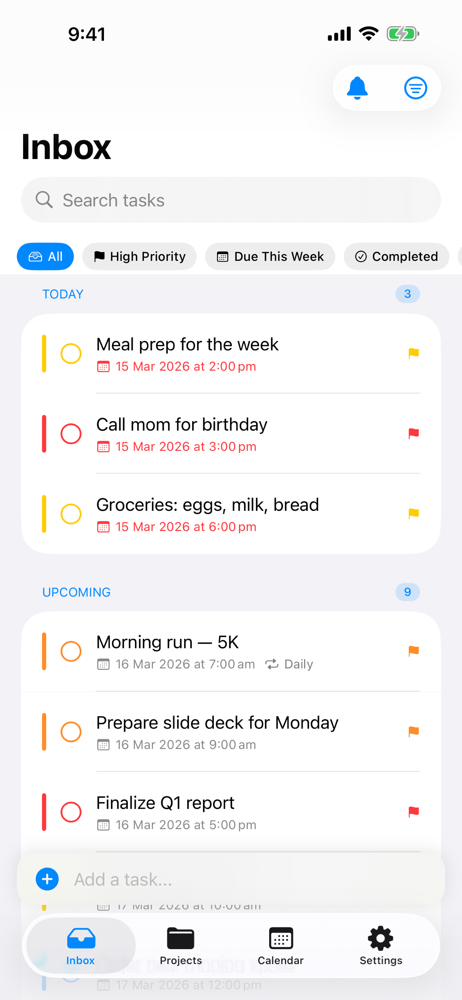
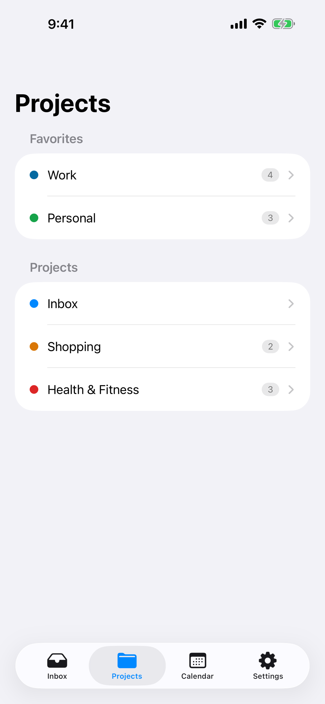
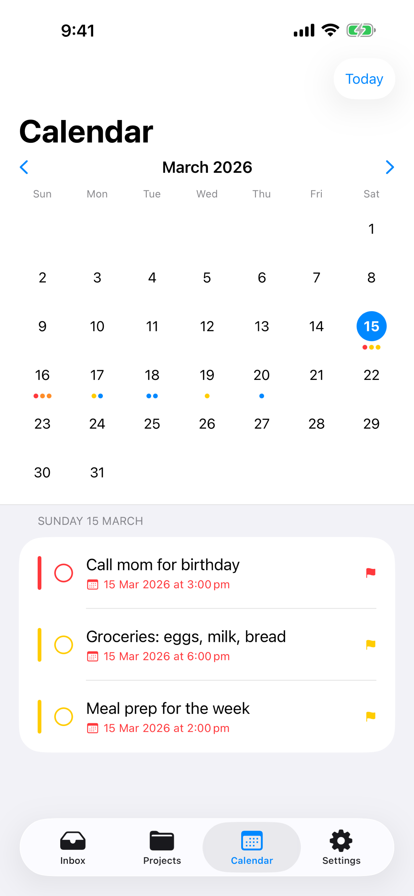
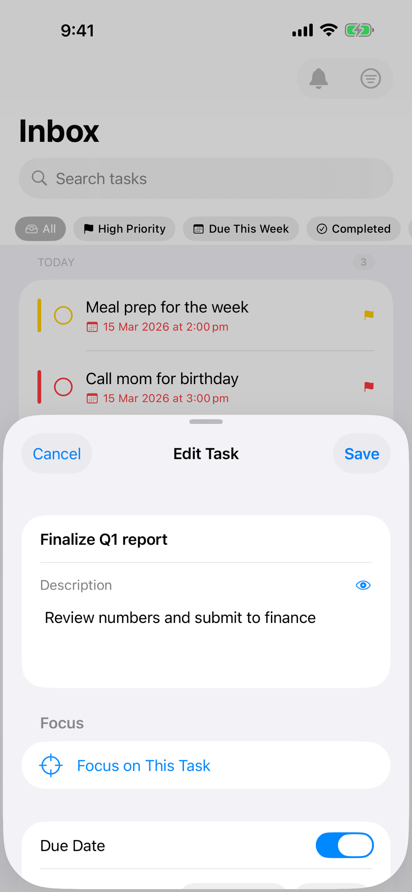
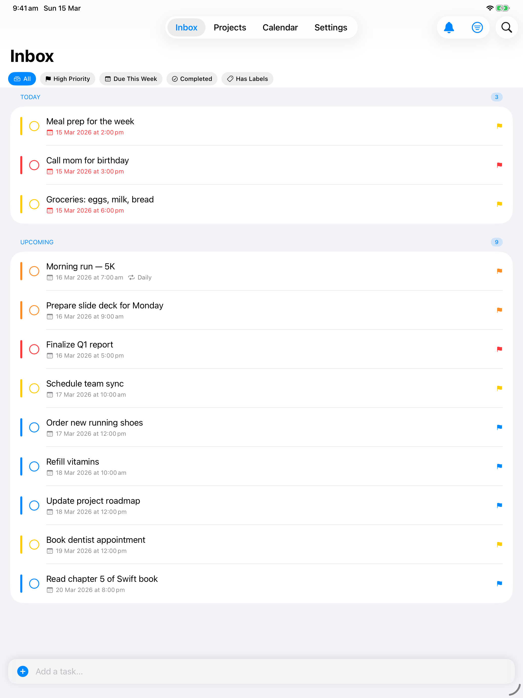
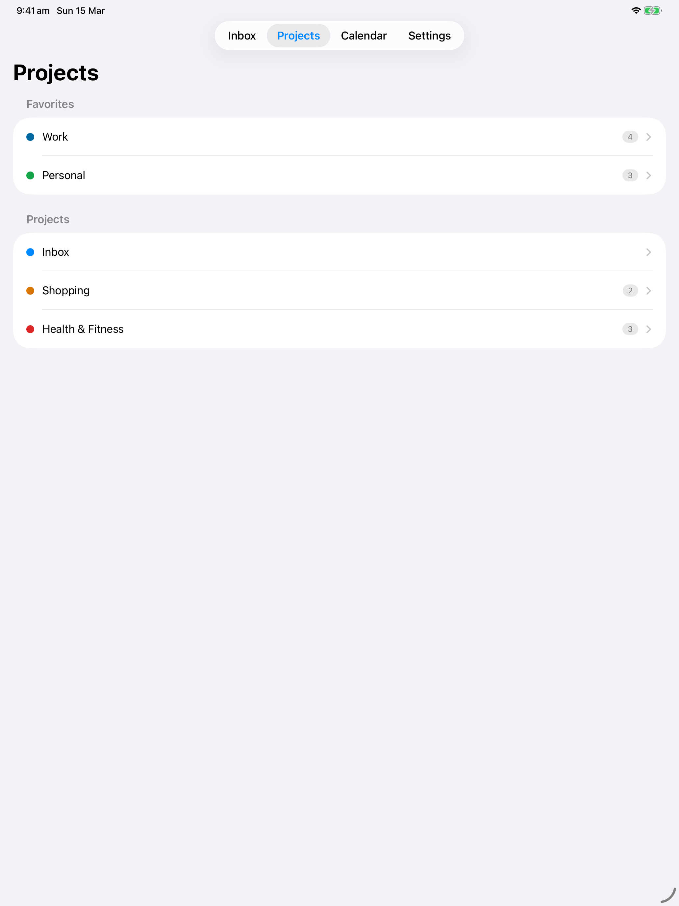

# mDone

[](LICENSE)
[]()
[](https://swift.org)
[](https://github.com/marco308/mdone/actions/workflows/ios-tests.yml)
[](https://codecov.io/gh/marco308/mdone)

A native iOS and macOS task management app for your self-hosted [Vikunja](https://vikunja.io) server. A polished, focused interface for your self-hosted productivity setup.

## Screenshots

### iPhone

<p align="center">
  
  
  
  
</p>

### iPad

<p align="center">
  
  
</p>

## Features

- **Smart Lists** — Today, Upcoming, and Overdue views so you always know what to focus on next
- **Projects & Favorites** — Organize tasks into projects and pin your most-used ones to the sidebar
- **Home Screen & Lock Screen Widgets** — See your tasks at a glance without opening the app
- **Focus Timer with Live Activities** — Built-in timer with Dynamic Island and lock screen support
- **Repeating Tasks** — Daily, weekly, monthly, or custom intervals with automatic next-occurrence generation
- **Calendar View** — Visualize your tasks across days and weeks
- **Offline Support** — Local caching with automatic sync when connectivity is restored
- **Privacy First** — Zero analytics, zero tracking, zero third-party SDKs. Talks only to your Vikunja server

## Requirements

- iOS 18.0+ or macOS 15.0+
- A self-hosted [Vikunja](https://vikunja.io) server, version 2.4.0 or newer
- An account on that server

## Single Sign-On (OIDC)

If your Vikunja signs people in through an OpenID Connect provider such as Authelia, Authentik or Keycloak, mDone can use it too. Sign-in happens in the system browser, so passkeys, your password manager and your provider's two-factor all work as they do on the web. The app never sees your password.

Once SSO works in the Vikunja web frontend, there is **one extra step**: add mDone's callback to the Vikunja client at your identity provider.

```
mdone://oidc-callback
```

Keep the web frontend's existing redirect URI (`https://<your-vikunja>/auth/openid/<provider-key>`) and add this one next to it. Nothing changes in Vikunja's own config: mDone sends its callback with each sign-in, and Vikunja accepts it.

For Authelia, the client looks like this:

```yaml
identity_providers:
  oidc:
    clients:
      - client_id: 'vikunja'
        client_name: 'Vikunja'
        client_secret: '<hashed secret>'
        public: false
        authorization_policy: 'two_factor'
        redirect_uris:
          - 'https://vikunja.example.com/auth/openid/authelia'
          - 'mdone://oidc-callback'
        scopes: ['openid', 'profile', 'email']
        token_endpoint_auth_method: 'client_secret_post'
```

Then, in mDone, enter your server address. A **Continue with \<provider name\>** button appears below the password form. If your server has password login turned off, the button is the only way in.

**If it doesn't work:**

- **No button:** mDone shows one only when `/api/v1/info` lists a provider. Open `https://<your-vikunja>/api/v1/info` and check that `auth.openid_connect` has `"enabled": true` and a non-null `providers`. Vikunja expects `providers` as a map keyed by provider name, not a list. The list form, which older guides show, leaves `providers` as `null` without a clear error.
- **The provider shows an error page about the redirect URI, or the sign-in never returns to the app:** `mdone://oidc-callback` is missing from the client's redirect URIs, or is spelled differently.
- **You land in a new, empty account:** by default Vikunja creates a separate user for an SSO login rather than reusing an existing password account with the same name. If you already have an account with your tasks in it, see the `emailfallback` and `usernamefallback` provider options in [Vikunja's config docs](https://vikunja.io/docs/config-options/) **before** you sign in with SSO for the first time.

## Building from Source

The project uses [XcodeGen](https://github.com/yonaskolb/XcodeGen) to generate the Xcode project from `project.yml`. Pure Swift with SwiftUI — no external dependencies.

```bash
# Install XcodeGen (if needed)
brew install xcodegen

# Generate the Xcode project
xcodegen generate

# Build for iOS Simulator
xcodebuild -project mDone.xcodeproj -scheme mDone -sdk iphonesimulator \
  -destination 'generic/platform=iOS Simulator' build

# Build for macOS
xcodebuild -project mDone.xcodeproj -scheme mDone-macOS build

# Run tests
xcodebuild -project mDone.xcodeproj -scheme mDone -sdk iphonesimulator \
  -destination 'platform=iOS Simulator,name=iPhone 17' test
```

## Contributing

Contributions are welcome! Please see [CONTRIBUTING.md](CONTRIBUTING.md) for guidelines.

## Privacy

mDone does not collect, track, or share any personal data. The app communicates exclusively with the Vikunja server you configure. See the full [Privacy Policy](https://marco308.github.io/mdone/privacy-policy.html).

## License

[MIT](LICENSE)

## Links

- [Vikunja](https://vikunja.io) — The open-source task management platform mDone connects to
- [Issues](https://github.com/marco308/mdone/issues) — Report bugs or request features
